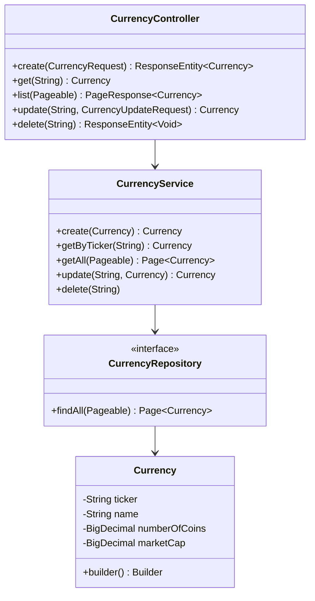

# CryptoAPI

REST API voor het beheren van crypto currencies (ticker, naam, aantal coins, market cap).
Gebouwd met Spring Boot, JPA en een in-memory H2 database.

## Starten

```
./mvnw spring-boot:run
```

De API draait op `http://localhost:8080`. Bij het opstarten wordt de database gevuld met
4 currencies (BTC, ETH, XRP, BCH) via `src/main/resources/data.sql`.

## Tests

```
./mvnw test
```

## Endpoints

| Methode | Endpoint                  | Omschrijving                        |
|---------|----------------------------|--------------------------------------|
| POST    | `/api/currencies`          | Nieuwe currency aanmaken             |
| GET     | `/api/currencies/{ticker}` | Eén currency ophalen                 |
| GET     | `/api/currencies`          | Lijst, met paging en sorting         |
| PUT     | `/api/currencies/{ticker}` | Currency bijwerken                   |
| DELETE  | `/api/currencies/{ticker}` | Currency verwijderen                 |

De ticker is de identifier (primary key), bv. `BTC`.

### Voorbeelden

Aanmaken:
```
curl -X POST http://localhost:8080/api/currencies \
  -H "Content-Type: application/json" \
  -d '{"ticker":"LTC","name":"Litecoin","numberOfCoins":73000000,"marketCap":5000000000}'
```

Ophalen met paging/sorting:
```
curl "http://localhost:8080/api/currencies?size=10&page=0&sort=ticker"
```

Bijwerken (ticker staat al in de URL, dus niet in de body):
```
curl -X PUT http://localhost:8080/api/currencies/LTC \
  -H "Content-Type: application/json" \
  -d '{"name":"Litecoin","numberOfCoins":74000000,"marketCap":5200000000}'
```

Verwijderen:
```
curl -X DELETE http://localhost:8080/api/currencies/LTC
```

### Response bij fouten

```json
{"timestamp":"2026-10-30T15:16:16.514","status":404,"error":"Not Found","message":"Currency not found: ZZZ"}
```

404 bij onbekende ticker, 409 bij een ticker die al bestaat, 400 bij validatiefouten.

## Logging

Elke call op `/api/**` wordt gelogd (methode, pad, statuscode, duur) naar de console en
naar `logs/cryptoapi.log` (zie `logback-spring.xml`).

## Opbouw

```
controller  -> service -> repository -> entity
   |              |
   dto       exception (404/409/400 afhandeling)
```



`Currency` wordt via het builder pattern gebouwd (`Currency.builder()...build()`), onder
andere in `CurrencyRequest.toEntity()` en `CurrencyUpdateRequest.toEntity()`.
